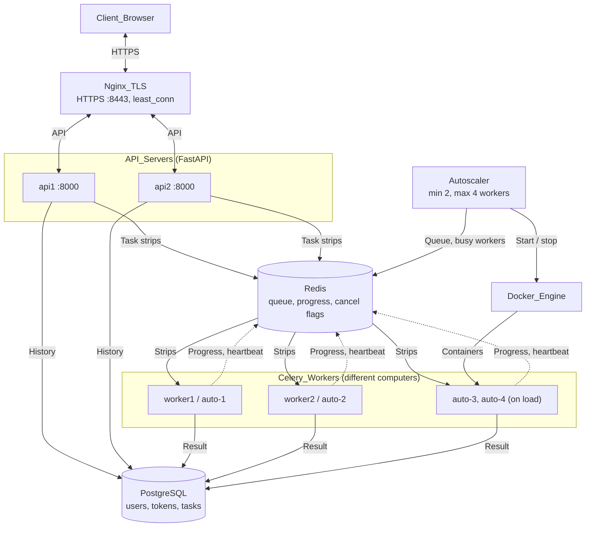

# Розподілена обробка зображень (веб-застосування з балансуванням навантаження)

Веб-застосування, backend якого обслуговує трудомісткі запити користувачів.
Задача: **згортка зображення з великим ядром** (розмиття Гаусса / підвищення різкості).
Одна задача ріжеться на горизонтальні смуги, і смуги паралельно рахують **воркери
на різних комп'ютерах**.

## Структура репозиторію

```
backend/        застосування: FastAPI, Celery, автомасштабувач, інтерфейс (app/static), тести
nginx/          Nginx: HTTPS і балансування
docs/           архітектура і скріншоти
scripts/        скрипти запуску та показу бази даних
samples/        тестове зображення
docker-compose.yml             основний запуск
docker-compose.worker.yml      воркер на іншому комп'ютері
docker-compose.autoscale.yml   автомасштабування
.github/workflows/             автозапуск тестів
```

## Архітектура



Два рівні балансування:

1. **Nginx** розподіляє HTTP-запити клієнтів між `api1` і `api2` (внизу сторінки
   видно, який API-сервер відповів).
2. **Черга Celery + Redis** розподіляє *обчислення* між воркерами на різних
   комп'ютерах. Воркер сам забирає смугу, коли має вільний слот
   (`prefetch_multiplier=1`), тому вільніші/потужніші комп'ютери беруть більше роботи.

API-сервери зображення **не рахують**: вони перевіряють дані, зберігають задачу
в базі й кладуть смуги в чергу. Воркерам потрібні лише Redis і PostgreSQL
(адреса головного вузла), жодних спільних файлів чи спільних процесів.

### Як виконується одна задача

1. Клієнт завантажує зображення; сервер перевіряє розмір, радіус і трудомісткість.
2. Зображення ріжеться на `N_STRIPS = 16` смуг. До кожної смуги додається запас
   у `radius` рядків від сусідів, щоб межі були без швів.
3. Кожна смуга стає окремою celery-задачею `process_strip` (група задач).
4. Воркери рахують смуги й після кожного рядка ядра збільшують лічильник
   прогресу в Redis, тож прогрес-бар рухається плавно.
5. Коли всі смуги готові, викликається `finalize_task` (celery `chord`):
   склеює смуги й зберігає результат у PostgreSQL.
6. Клієнт раз на секунду опитує `/api/tasks` і бачить відсоток, етап, воркерів.

## Відповідність пунктам завдання

| Пункт | Де реалізовано |
|---|---|
| 1. Обмеження трудомісткості | `config.py` (ліміти), перевірка у `main.py → create_task`, дублюється на клієнті в `static/app.js` |
| 2. Прогрес виконання | Redis-лічильники (`tasks.py`), відсоток і етап у `task_view` (`main.py`) |
| 3. Історія, стан, скасування, нова задача, ліміт задач, БД | таблиця `tasks` (`db.py`), ендпоінти `/api/tasks`, скасування через прапорець у Redis |
| 4. Авторизація + https (+бали) | `auth.py` (PBKDF2 + токени в БД), HTTPS у `nginx/` |
| 5. Балансування для ≥ 2 серверів (головне) | Nginx → api1/api2 **і** Celery/Redis → воркери на різних комп'ютерах |
| 6. (+бали) Повідомлення про чергу і час очікування | `estimate_wait` у `main.py`, показується у стовпці «Стан» |
| 7. (+бали) Автомасштабування | `backend/app/autoscaler.py` + `docker-compose.autoscale.yml` (див. розділ «Автомасштабування») |
| 8. (+бали) Адмін-панель | вкладка «Адмін-панель» (`/api/admin/overview`) |

## Запуск

Потрібен Docker Desktop. У PowerShell, у папці проєкту:

```
copy .env.example .env
docker compose --profile local-workers up -d --build
```

Відкрийте **https://localhost:8443** (браузер попередить про самопідписаний
сертифікат: «Додатково → Продовжити»). Зареєструйтесь, завантажте
`samples/sample.png` і запустіть обробку.

Щоб користуватись адмін-панеллю, зареєструйте користувача з логіном `admin`
(значення `ADMIN_USERS` у `.env`).

Зупинити проєкт:

```
docker compose --profile local-workers down
```

## Автомасштабування (пункт 7)

Окремий сервіс `autoscaler` стежить за чергою задач у Redis і керує кількістю
контейнерів-воркерів через Docker Engine API:

* **Збільшення.** Якщо в черзі є задачі 2 перевірки поспіль (кожні 3 с), запускається
  новий воркер. Кількість воркерів обмежена
  `AUTOSCALE_MAX_WORKERS` (за замовчуванням **4**).
* **Зменшення.** Якщо черга порожня і всі слоти вільні 30 с (`AUTOSCALE_IDLE_SEC`),
  зупиняється один автоматично запущений воркер, але завжди залишається не менше 2.
  Зайнятий воркер не чіпається, тож задача не обривається.
* Між діями є пауза 8 с, щоб система не «смикалась» від коротких сплесків.
* Стан видно в адмін-панелі (блок «Автомасштабування»).

Запуск:

```bash
docker compose -f docker-compose.yml -f docker-compose.autoscale.yml --profile autoscale up -d --build
```

Перевірка: запустіть 2 задачі з великим радіусом. Дивіться лог командою
`docker compose -f docker-compose.yml -f docker-compose.autoscale.yml --profile autoscale logs -f autoscaler`: з'являться рядки
`запущено webproject-auto-1`, а в адмін-панелі кількість воркерів зросте з 2 до 3–4.
Через ~30 с після завершення задач зайві воркери будуть зупинені.

Тест логіки (без Docker): `python tests/test_autoscaler.py` у папці `backend`.


## Тест обчислень (без Redis і бази)

```bash
cd backend
pip install numpy Pillow
python tests/test_imaging.py
```

Перевіряє, що склеєний зі смуг результат **побітово збігається** з обробкою
цілого зображення.

## Обмеження (змінюються у `.env`/`config.py`)

| Параметр | Значення за замовчуванням |
|---|---|
| Максимальна сторона зображення | 1200 px |
| Розмір файлу | 3 МБ |
| Радіус ядра | 1–15 |
| Складність `ширина × висота × (2r+1)²` | ≤ 1 500 000 000 |
| Активних задач на користувача | 2 |
| Задач в історії на користувача | 15 |
